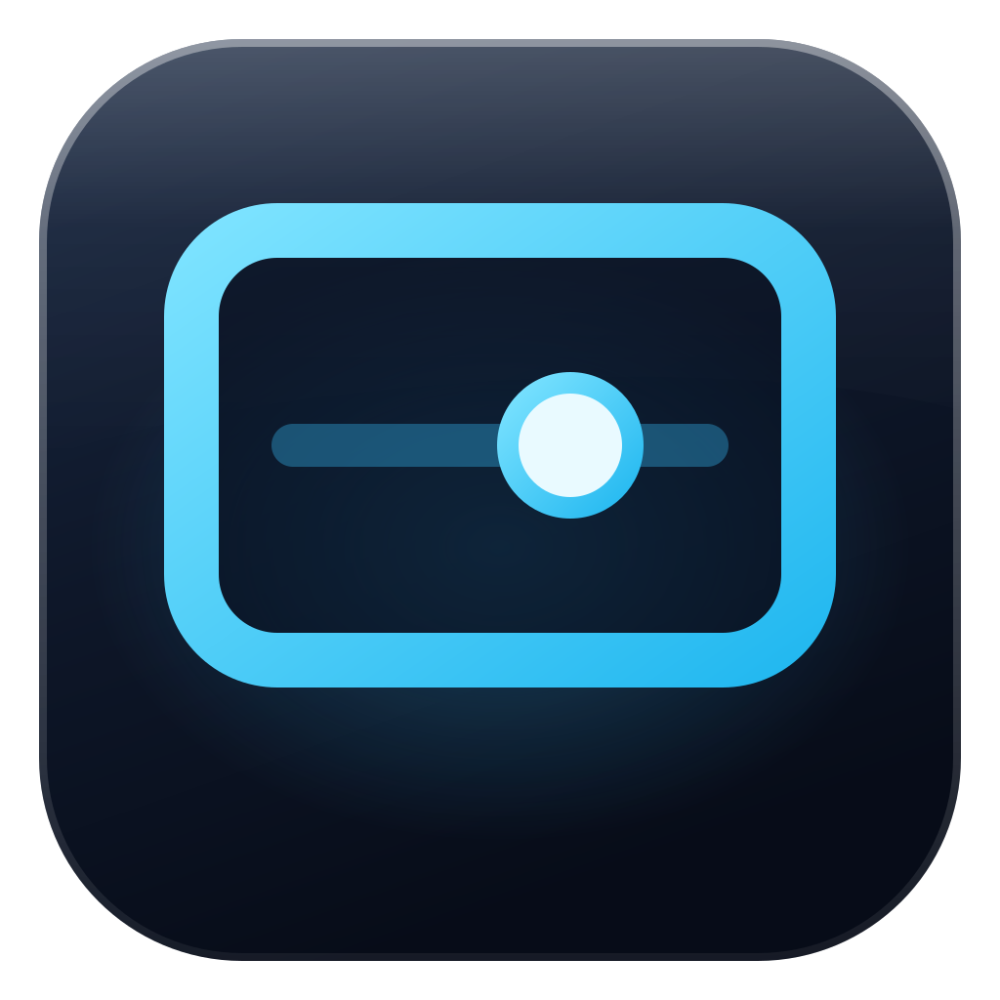

<p align="center"></p>

<h1 align="center">IBRA TV Tuner</h1>

<p align="center">تخصيص واجهة التلفزيون الذكي والـTV Box وإدارة التطبيقات الزائدة من الحاسبة عبر الشبكة المحلية.<br>
Customise smart-TV and TV-box home screens and manage bloat from your Windows PC over the local network.</p>

> **الحالة / Status:** v0.1.0 — first build. Core logic is covered by automated tests; **nothing has been run on a real TV yet** (see [docs/TESTING.md](docs/TESTING.md)).

---

## بالعربي

### شنو يسوي
- **الأجهزة:** إضافة جهاز بالـIP والمنفذ، أو Wireless debugging (منفذ اقتران + رمز، ومنفذ اتصال منفصل)، أو USB، أو اكتشاف بالشبكة. الشاشة والبوكس جهازين مستقلين، وكل تعديل يبيّن اسم الجهاز المستهدف.
- **المظهر:** معاينة داخل البرنامج (خلفية، مفضلة، ترتيب البلاطات، أعمدة، ألوان)، ثم: تثبيت واجهة IBRA ← إرسال الشكل ← فتحها للتجربة ← تعيينها رئيسية.
- **واجهة IBRA HOME على التلفزيون:** بطاقات **طقس** (بغداد، 5 أيام)، **مباريات اليوم** (أبطال أوروبا، الدوريات الخمسة، الدوري الأوروبي، السعودي، كأس العالم — مباشر ونتائج بتوقيت بغداد)، و**حلقات جديدة اليوم**. صف **تطبيقات عراقية** (سينمانا، YouTube، شاهد، Netflix، Prime Video، Downloader): المثبّت يفتح، وغير المثبّت يودّيك لصفحته بالمتجر. ضغطة مطوّلة أو زر MENU على البطاقة = تحديث. المصادر: Open-Meteo وESPN وTVmaze عبر HTTPS فقط، وما يُرسل أي شي عن الجهاز. لا تحديث ذاتي ولا تنزيل APK من سيرفرات خارجية.
- **رجوع للشكل القديم:** البرنامج يحفظ الواجهة الأصلية قبل أي تغيير، وزر واحد يرجّعها كواجهة رئيسية ويتحقق، مع خيار حذف واجهة IBRA. ويوجد كذلك «رجوع للإعدادات السابقة» للشكل، وبلاطة «الواجهة الأصلية» داخل واجهة IBRA على التلفزيون نفسه.
- **التطبيقات:** جرد كامل (الحزمة، النوع، الحالة، نظام أو مستخدم) مع تصنيف: محمية / قابلة للمراجعة / غير معروفة، وقوائم توصيات مربوطة بالموديل. الافتراضي **تعطيل** قابل للإرجاع؛ الإزالة خيار منفصل متقدم.
- **التغييرات والاسترجاع:** كل دفعة تُحفظ قبل التنفيذ، كل خطوة يُعاد التحقق منها من الجهاز، والاسترجاع يرجّع الحالة المسجّلة قبل التغيير.
- **التوافق:** مصفوفة تُرسم من الكود نفسه: مدعومة / تحتاج إعداداً / غير مدعومة / غير مختبرة.
- **قياس:** وقت فتح الواجهة أو تطبيق (am start -W) قبل وبعد، بدون ادعاء تسريع.

### ربط التلفزيون أو البوكس عبر Wi-Fi
1. على التلفزيون: الإعدادات ← تفضيلات الجهاز ← حول ← اضغط OK على **الإصدار/Build** 7 مرات.
2. خيارات المطوّر ← فعّل **تصحيح USB** و/أو **ADB عبر الشبكة**.
3. اعرف IP التلفزيون من إعدادات الشبكة.
4. بالبرنامج: الأجهزة ← إضافة جهاز ← اكتب الـIP والمنفذ `5555` ← إضافة واتصال ← اضغط **سماح** على التلفزيون.

**Android 11+ (Wireless debugging):** شاشة «Pair device with pairing code» تعطي **منفذ اقتران** ورمز 6 أرقام؛ الشاشة الرئيسية تعطي **منفذ اتصال** مختلف. اكتب الاثنين. الرمز لا يُحفظ ولا يُسجَّل.

الحاسبة تقدر تكون على **Ethernet** والتلفزيون على **Wi-Fi** إذا كانوا على نفس الراوتر وما في عزل بين الأجهزة.

### ADB
ما يُرفق ADB داخل البرنامج لأن ترخيص Google لا يسمح بإعادة التوزيع. البرنامج يلگى `adb.exe` الموجود، أو تختاره، أو يحمّل Platform-Tools الرسمية من Google بعد موافقتك.

### الأمان
بدون root، بدون فلاش، بدون فتح bootloader. ما تُرسل أي أوامر نصية حرة لـADB؛ كل إجراء من قائمة ثابتة ويتحقق من مدخلاته. المكونات الأساسية (System UI، الإعدادات، الواجهة الحالية، لوحة المفاتيح، خدمات الشبكة…) محمية. لا يُرفع أي شيء لأي خدمة خارجية؛ البيانات في `%LOCALAPPDATA%\IbraTvTuner`. البرنامج يشتغل بصلاحيات المستخدم العادي.

---

## English

### Build
```bash
# Android launcher + self-test APK (no Gradle needed)
sudo apt-get install android-sdk-platform-23 aapt dalvik-exchange zipalign apksigner openjdk-17-jdk-headless
android/build.sh                       # → android/out/*.apk

# Core tests (any OS with the .NET 10 SDK)
dotnet run --project tests/IbraTvTuner.Core.Tests -c Release

# Windows app (on Windows, .NET 10 SDK)
dotnet publish src/IbraTvTuner.App -c Release -r win-x64 --self-contained true ^
  -p:PublishSingleFile=true -p:IncludeNativeLibrariesForSelfExtract=true -o publish
```
CI (`.github/workflows/build.yml`) does all three, uploads the portable EXE and the APKs, and keeps a draft release up to date.

### Layout
| Path | What |
|---|---|
| `src/IbraTvTuner.Core` | ADB actions (fixed list, validated), device session, package classifier, change journal + rollback, launcher manager + Home backup/restore, discovery, timing. Platform modules decide what each OS may do. |
| `src/IbraTvTuner.App` | WPF UI (Arabic RTL / English): Devices, Appearance, Apps, Changes & restore, Compatibility. |
| `android/launcher` | IBRA HOME launcher (Java, Android 5+): weather / football / today's-episodes cards (Open-Meteo, ESPN, TVmaze; cached, offline-safe), Iraqi apps row with store links for missing apps, D-pad, OK, long-press/MENU options, BACK stays home, Arabic/English. |
| `android/testapp` | Harmless app used only by the self-test. |
| `tests/` | Dependency-free test runner with an in-memory fake TV. |
| `tools/build_catalog.py` | Regenerates the model recommendation catalog from CleanYourTV (MIT). |

### Compatibility (what is really implemented)
| Platform | Status in v0.1.0 |
|---|---|
| Android TV / Android TV Box | Implemented, **untested on hardware** |
| Google TV | Implemented, **untested on hardware**; Google TV may take Home back, so the app verifies after setting it |
| Fire TV | Inventory/disable implemented (untested); **Home replacement blocked** (Fire OS does not allow it) |
| Samsung Tizen, LG webOS, Hisense VIDAA, Roku | Listed, **not supported** (no ADB) — later phases |
| CoreELEC / LibreELEC | Reference only |

### Licence
MIT — see [LICENSE](LICENSE). Reused material and reviewed projects: [THIRD_PARTY_NOTICES.md](THIRD_PARTY_NOTICES.md).

Designed & developed by **إبراهيم الخزرجي** · [t.me/ibraprogram](https://t.me/ibraprogram) · TikTok [@ibraprogram](https://www.tiktok.com/@ibraprogram)
